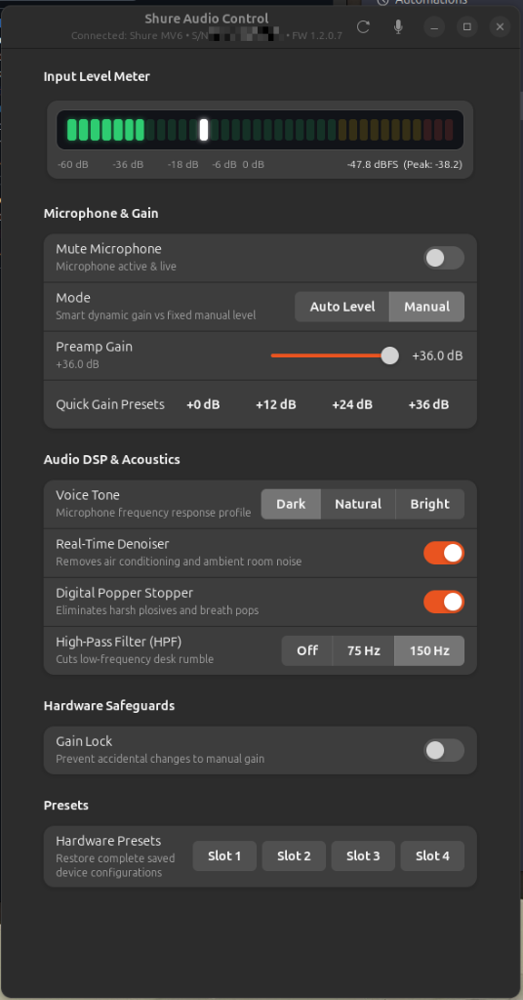

# Shure Audio Control (`shurectl-gui`)

A native Linux desktop GUI application (built with **GTK 4** & **Libadwaita**) for controlling and monitoring **Shure USB Microphones** (MV6, MV6 Gen 2, MV7, MV7+, MVX2U) on GNOME / Wayland / X11.

Powered by [`shurectl`](https://github.com/Humblemonk/shurectl) and **PipeWire / WirePlumber**.



---

## ✨ Features

- **Real-Time 36-Segment Studio VU Level Meter**:
  - Hardware-accelerated GTK 4 CSS/GSK LED level bar (`-60 dBFS` to `0 dBFS`) with green, amber, and red thresholds.
  - Live Peak Hold indicator and digital dBFS readout streamed via PipeWire (`pw-record`).
- **Microphone & Preamp Controls**:
  - **Quick Mute**: Header bar and main switch with synchronized hardware + PipeWire mute state.
  - **Auto Level vs. Manual Mode**: Switch between smart dynamic gain and manual preamp control.
  - **Preamp Gain Slider**: `0.0 dB` to `+36.0 dB` in `0.5 dB` steps, plus one-click preset buttons (`+0 dB`, `+12 dB`, `+24 dB`, `+36 dB`).
- **Onboard Hardware DSP Controls**:
  - **Voice Tone Profile**: `Dark (-10)`, `Natural (0)`, `Bright (+10)`.
  - **Real-Time Denoiser**: Hardware DSP toggle to filter ambient room and fan noise.
  - **Digital Popper Stopper**: Hardware plosive reduction.
  - **High-Pass Filter (HPF)**: `Off`, `75 Hz`, or `150 Hz` low-end rumble filter.
  - **Gain Lock**: Lock manual preamp gain to prevent accidental changes.
- **Hardware Presets**:
  - One-click recall for hardware preset slots `Slot 1` – `Slot 4`.
- **Automatic USB-C Hotplug & Default Input Selection**:
  - Automatically detects USB-C hotplug events and sets the Shure microphone as the default PipeWire input source (`@DEFAULT_AUDIO_SOURCE@`).

---

## 🚀 Requirements

- Linux with **PipeWire** & **WirePlumber** (`wpctl`, `pw-record`)
- Python 3 with PyGObject (`python3-gi`, `gir1.2-gtk-4.0`, `gir1.2-adw-1`)
- [`shurectl`](https://github.com/Humblemonk/shurectl) installed in `~/.local/bin/shurectl` (with `--json` and `--set` CLI support)

---

## 📦 Installation

```bash
./install.sh
```

### Non-Root USB HID Permissions (`udev` rule)

To allow hardware DSP control without `sudo`, install the included udev rule:

```bash
sudo cp 62-shure.rules /etc/udev/rules.d/62-shure.rules
sudo udevadm control --reload-rules && sudo udevadm trigger
```

---

## 🖥️ Usage

Launch from your GNOME application launcher (**"Shure Audio Control"**) or run from the terminal:

```bash
shurectl-gui
```
